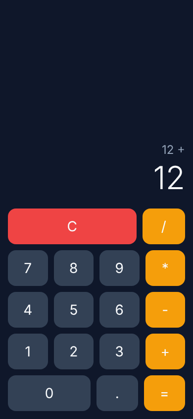
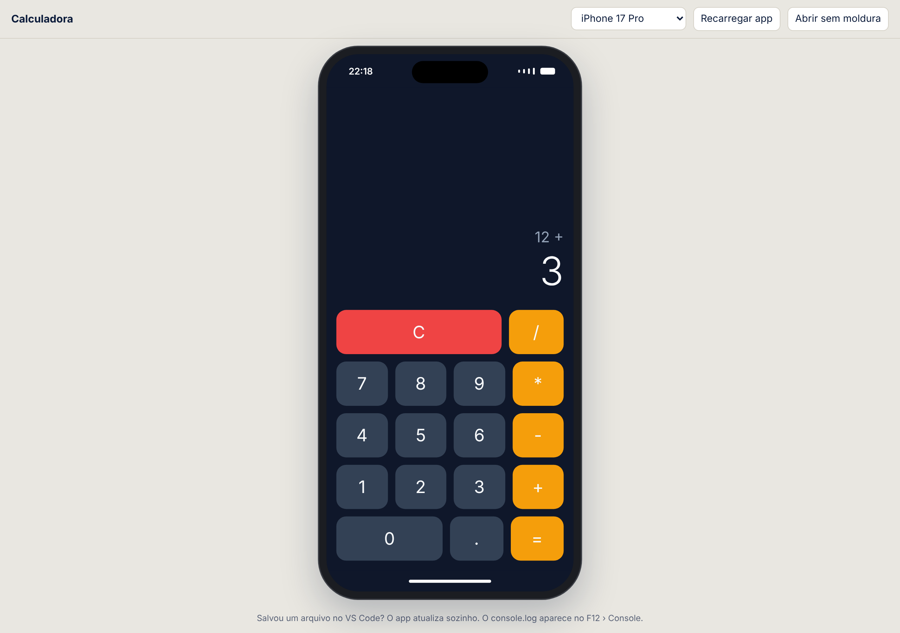

# Calculadora (laboratório bônus)

Calculadora de quatro operações feita em React Native com Expo, no laboratório bônus da disciplina **Desenvolvimento para Dispositivos Móveis** (prof. Arnaldo, FATEC Araraquara, 2º semestre de 2026).

É um sub-projeto do app do semestre, a **Vitrine** ([Felpz016/vitrine-mobile](https://github.com/Felpz016/vitrine-mobile)). Fica em um repositório separado porque o roteiro pede um projeto novo, fora da pasta da Vitrine. O objetivo é praticar, um de cada vez, os cinco conceitos que a Vitrine usa em toda tela: **componente, JSX, props, evento e estado**.



## O que ela faz

- Soma, subtrai, multiplica e divide, com números decimais.
- Botão **C** para limpar tudo.
- Mostra **Erro** na divisão por zero; o próximo número começa uma conta nova.
- O resultado vira o primeiro número da conta seguinte (`2 + 3 =` e depois `* 4 =` dá `20`).

## Stack

| Item | Versão |
| --- | --- |
| Expo | SDK 57 (o mesmo da Vitrine e do Expo Go) |
| React Native | 0.86 |
| React | 19.2.3 (`react-dom` preso na mesma versão) |
| TypeScript | estrito |
| Web | `react-native-web` + `@expo/metro-runtime` |

Diferente da Vitrine, aqui **não há** Expo Router nem NativeWind: o modelo `blank-typescript` tem uma tela só e estilos com `StyleSheet`.

## Estrutura

| Caminho | O que é |
| --- | --- |
| `App.tsx` | Componente raiz: os quatro estados (`visor`, `primeiro`, `operador`, `novoNumero`) e o teclado |
| `src/components/Visor.tsx` | Mostra a conta pendente e o número grande (só recebe props) |
| `src/components/Botao.tsx` | Botão reutilizável; avisa o pai pelo evento `aoTocar` |
| `src/calcular.ts` | Funções puras `calcular` e `formatar`, sem React |
| `tests/calcular.test.ts` | Testes da conta com o test runner do próprio Node |
| `public/simulador.html` | Simulador: o app web dentro de uma moldura de celular |
| `iniciar.cmd` / `iniciar.ps1` | Atalho de um clique que liga o Expo e abre o simulador |
| `docs/bonus-calculadora.md` | Explicação do laboratório passo a passo |

## Como rodar

### Com simulador de celular no navegador (Windows)

Dê dois cliques em `iniciar.cmd` na pasta do projeto (ou rode `.\iniciar.cmd` no PowerShell). Ele instala as dependências na primeira vez, liga o Expo e abre no navegador o **simulador**: a calculadora dentro de uma moldura de celular, sem precisar do Expo Go.

- Endereço: http://localhost:8081/simulador.html (dá para trocar o aparelho no topo: iPhone 17 Pro, Pro Max, SE ou Android).
- Salvou um arquivo? O app no simulador atualiza sozinho. O `console.log` aparece no F12 › Console.
- O QR code continua no terminal, para conferir também no celular (alguns erros só aparecem no aparelho).



### Manualmente

No PowerShell, na pasta onde ficam os projetos (ao lado da `vitrine-mobile`, não dentro dela):

```powershell
git clone https://github.com/Felpz016/Calculadora_Mobile.git
cd Calculadora_Mobile
npm install
npx expo start        # QR code para o Expo Go; tecla w abre no navegador
```

Outros comandos, em um segundo terminal:

```powershell
npm run check   # TypeScript (tsc --noEmit), precisa terminar sem mensagens
npm test        # testes de src/calcular.ts
npm run web     # abre direto no navegador
```

## Documentação

- [Laboratório bônus: calculadora](docs/bonus-calculadora.md)
